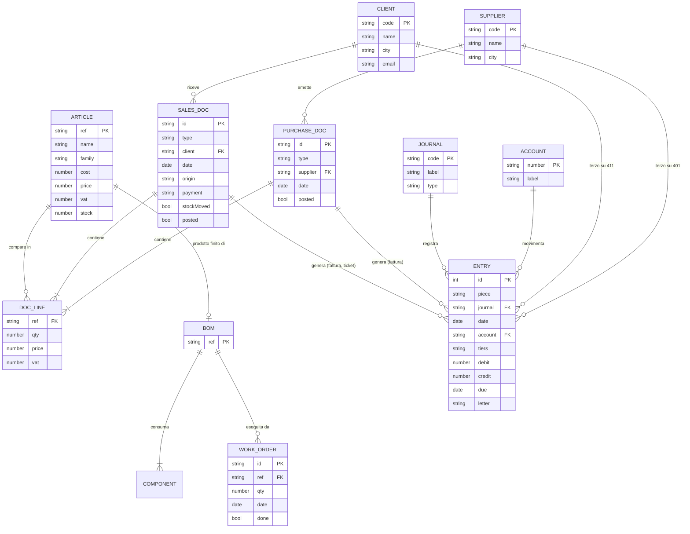

# Fase 4 — Dati

## Dove stanno i dati

| Luogo | Cosa | File |
|---|---|---|
| PC del cliente | Copia di lavoro (SQLite) | `%APPDATA%\AICOM\data-<id account Google>.sqlite` |
| PC del cliente | Token Google cifrato dal sistema operativo | `%APPDATA%\AICOM\auth.bin` |
| PC del cliente | Salvataggi automatici prima di ripristini e conflitti | `%APPDATA%\AICOM\backups\` |
| Google Drive del cliente | Copia sincronizzata, con cronologia versioni | cartella `AICOM`, file `aicom-data.json` e archivi del registro attività `aicom-audit-<da>-<a>.json` |
| Tuo servizio licenze | Solo licenze e PC attivati | Firestore, raccolta `licenses` |

Un database locale per ogni account Google: cambiando account non si mescolano mai i dati di due aziende.

## Schema (T25)

Le definizioni di riferimento sono i tipi in `apps/ledgerflow/src/sageData.ts`.

Fuori dal diagramma, due raccolte alimentano le sezioni di lavoro: `supplierInvoices` (fatture fornitori ricevute, in attesa di convalida; alla convalida generano una scrittura nel giornale acquisti) e `bankLines` (righe dell'estratto conto importato; alla riconciliazione generano una scrittura nel giornale di banca). Le spunte della chiusura mensile sono in `closeTasks`. Dei documenti importati (PDF, XML) si salvano i dati estratti, **non il file**.

Nel database locale ogni record è una riga della tabella `records (collection, id, data)`; la corrispondenza tra raccolte e chiavi è in `src/sageSnapshot.ts`. Le altre tabelle sono `audit` (registro attività) e `settings` (stato della sincronizzazione, solo locale).

## Sincronizzazione con Drive (T26)

1. Ogni modifica è scritta subito nel database locale.
2. Dopo 4 secondi senza altre modifiche l'app carica `aicom-data.json` su Drive, compresso con gzip per ridurre il traffico sulle connessioni lente. Il nome resta `.json` perché le versioni precedenti trovino lo stesso file; la lettura accetta sia il formato compresso sia il JSON semplice scritto dalle versioni precedenti (`decodeData` in `electron/drive.ts`).
3. Il registro attività non viaggia per intero a ogni salvataggio. Quando le righe non ancora archiviate arrivano a 250 (`AUDIT_CHUNK_ROWS` in `electron/sync.ts`), l'app le scrive una sola volta in un file `aicom-audit-<da>-<a>.json`, che non cambia più. `aicom-data.json` contiene i dati, le righe successive all'ultimo archivio e l'elenco degli archivi (`auditArchive`). Ogni PC scarica un archivio una sola volta e tiene sempre il registro completo in locale. I backup locali contengono sempre il registro completo. Con 3.300 righe di registro, un salvataggio passa da circa 76 KB a circa 4 KB inviati. Dal formato 3 (`schemaVersion`) le versioni precedenti dell'app chiedono di essere aggiornate invece di leggere il file.
4. Ogni 60 secondi l'app controlla se Drive contiene una versione più recente e, se sì, la scarica.
5. Alla chiusura l'app invia le modifiche ancora in attesa.

L'app ricorda quale versione di Drive ha visto per ultima. La decisione è nella funzione `decideSync` di `electron/sync.ts`:

| Drive è cambiato? | Questo PC ha modifiche non inviate? | Azione |
|---|---|---|
| no | no | niente |
| no | sì | invio |
| sì | no | scarico |
| sì | sì | **conflitto** |

## Conflitti (T27)

Due protezioni:

- **Blocco**: all'apertura l'app segna sul file di Drive «aperto sul PC X». Un secondo PC che apre l'app entro 2 minuti e mezzo vede un avviso e può *prendere la mano* o uscire. Chiudendo l'app il blocco si libera.
- **Scelta della versione**: se nonostante il blocco due PC hanno modificato i dati (tipicamente entrambi offline), l'utente sceglie quale versione tenere. L'altra non si perde: se tiene la versione del PC, quella di Drive resta nella cronologia di Drive; se tiene la versione di Drive, quella del PC è salvata in `backups\conflict-<data>.json`.

Non c'è fusione automatica delle due versioni: su dati contabili una fusione sbagliata è peggio di una scelta esplicita.

## Versioni dello schema (T29)

- Database locale: l'elenco `migrations` in `electron/database.ts`. Ogni aggiornamento dell'app applica da solo le migrazioni mancanti. **Mai modificare una voce già pubblicata**: se ne aggiunge una nuova.
- File di scambio (Drive e backup): campo `schemaVersion`; le conversioni vanno in `dataUpgrades`.
- Un'app vecchia che incontra dati più recenti **si rifiuta di aprirli** e chiede di aggiornare, invece di rovinarli.

## Registro attività (T30)

Ogni salvataggio confronta lo stato nuovo con quello precedente e registra, per ogni record creato, modificato o eliminato: data e ora, account Google, nome del PC, raccolta, identificativo, motivo (l'azione dell'utente) e il valore **prima e dopo**. Il registro fa parte dei dati: è sincronizzato e si vede da tutti i PC, alla voce *Journal d'activité*.

Limite: il registro vive nello stesso file dei dati e il cliente, proprietario del file, potrebbe alterarlo. Non è un archivio a prova di manomissione.

## Credenziali e storico degli accessi

**Credenziali.** Dopo l'installazione l'app chiede di creare un identificativo e una password; li richiede poi a ogni apertura. Gli utenti stanno nei dati dell'azienda (raccolta riservata `_users`), quindi nel file su Drive: le stesse credenziali valgono su tutti i PC del cliente. Si salvano solo l'impronta della password (scrypt con sale) e mai la password. L'interfaccia non riceve questa raccolta e non può sovrascriverla. Il primo utente è amministratore e può aggiungere o disattivare gli altri; un utente non si elimina, si disattiva.

Alla creazione di ogni utente viene mostrato una sola volta un **codice di soccorso**, unico modo per reimpostare la password dimenticata. Chi perde sia la password sia il codice non può più entrare, e nemmeno noi possiamo aiutarlo. Dopo 5 tentativi sbagliati l'accesso è sospeso per 30 secondi.

**Storico degli accessi.** Ogni accesso, uscita, tentativo rifiutato, creazione o disattivazione di un utente e cambio password produce una riga con giorno e ora, utente e PC. Si consulta in *Piste d'audit → Accès au logiciel* e si esporta in Excel.

Cosa garantisce che non venga cancellato:

- nell'app non esiste alcun comando per modificare o eliminare una riga;
- il database stesso rifiuta le modifiche e le eliminazioni su quella tabella, da qualunque codice provengano;
- svuotare i dati, importare un backup o ripristinare una versione precedente **aggiunge** righe e non ne toglie mai; lo stesso vale tra due PC, le cui righe vengono unite;
- ogni riga è sigillata con la precedente dello stesso PC: una riga alterata o tolta a mano dal file viene segnalata come «Historique altéré».

Limite da dire con chiarezza al cliente: il file sta nel suo PC e nel suo Drive, di cui è proprietario. Chi ne ha il controllo può cancellare l'intero file, o tagliare le ultime righe senza che il sigillo se ne accorga. Lo storico è quindi non cancellabile **dall'applicazione** e a prova di alterazione parziale, non un archivio certificato presso terzi.

## Backup e ripristino (T31)

- **Cronologia di Drive**: Google conserva le versioni precedenti del file per circa 30 giorni (o 100 versioni). In *Paramètres → Sauvegardes* si vedono e si ripristinano. Prima di ripristinare, lo stato attuale è salvato in `backups\before-restore-<data>.json`.
- **Backup manuale**: *Exporter une sauvegarde…* salva un file `.json` dove vuole il cliente; *Importer une sauvegarde…* lo ricarica.
- **Excel**: *Exporter les données en Excel* produce un file leggibile senza AICOM.

Il ripristino è verificato da test automatici contro un Drive simulato. **Resta da fare una prova con un Drive reale** (vedi `docs/05-test.md`).

## Dati di esempio (T32)

`createStore()` in `src/sageData.ts` crea l'azienda di esempio. Al primo avvio il cliente può sceglierla spuntando *Charger des données d'exemple*; altrimenti parte con il solo piano dei conti e i giornali (`createEmptyStore`).
